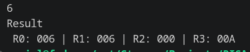

# **RISA (R Instruction Set Architecture)**


> ^ The RGMS 1000 CPU

R Instruction Set Architecture - The rules I made for the processor

> This repo includes not just the instruction set, but also the .circ of the RGMS 1000 CPU for Logisim, RIAS (the assembler-simulator for the RGMS 1000), and the R assembly-like language.

### **RGMS 1000**
It is a CPU I made in Logisim to learn how a basic processor is made (for my 113 class). 

### **RIAS (RIsa Assembler-Simulator)**
Includes the assembler (converts any .r file into an output.hex that can be ran directly on the Logisim CPU) and a runner (directly run any .r file without having to pass it onto the CPU)

### **The R Programming Language**
A assembly-like language I made for the CPU. It is accurate by default but can be a lot more powerful (--unlimited).

> Check the dedicated documentation below for more details.

### Screenshots
> Examples/gcd.r



### How To Run (Linux)
Step 1: Compile using gcc (skip if using the included binary)
```bash
  gcc rias.c -o rias
```
Step 2: Give execution permission to rias (terminal must be in the folder of rias)
```bash
  chmod +x ./rias 
```
Step 3: Run any .r file (defaults to program.r in the same location as rias)
```bash
  ./rias
```
> ./rias --unlimited to remove the 256 x 12-bit limit, and ./rias {path-to-.r-file}.r for other programs

# R - DOCUMENTATION
// R uses double-slash (//) for comments, similar to C.
> SETC Rx INTO C. // Assign Register into a value  
> COPY Rx FROM Ry. // Copy/move R1  into R0  
> CLER Rx. // Clear Rx  
> NEGT Rx. // Rx != R3  
> PRNT Rx. // Print Register  
> HALT. // Makes your code accurate to the CPU  

// N means Register operation, C means constant operation
> ADDN Rx Ry.
> ADDC Rx C.  
> SUBN Rx Ry.  
> SUBC Rx C.  
> ANDN Rx Ry.  
> ANDC Rx C.  
> ORON Rx Ry.  
> OROC Rx C.  

> DOIF GRET Rx. ... ENDN.  
> DOIF LESS Rx. ... ENDN.  
> DOIF YEQL Rx. ... ENDN.  
> DOIF NEQL Rx. ... ENDN.  

> LOOP. ... ENZO [Rx]. // ENd Zer0  
> LOOP. ... ENNZ [Rx]. // ENd Not Zero  
> LOOP. ... ENNG [Rx]. // ENd Not Greater  
> LOOP. ... ENNL [Rx]. // ENd Not Lesser
