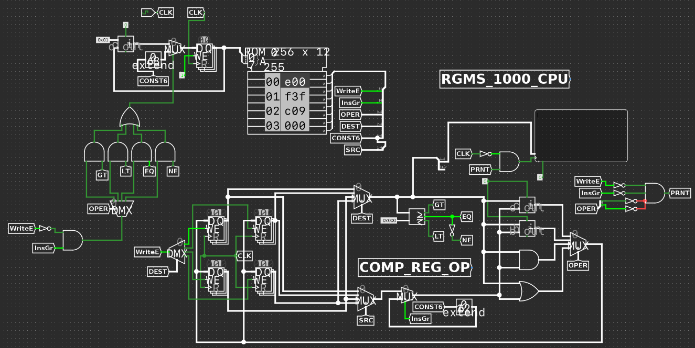
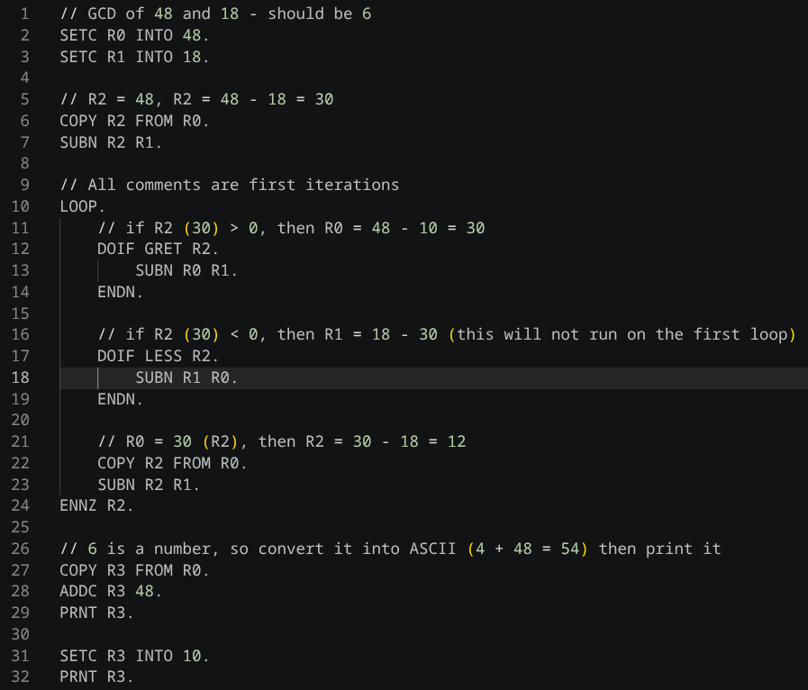

# **RISA (R Instruction Set Architecture)**
R Instruction Set Architecture - The rules I made for the processor, it features:
- A strict 12-bit implementation
- 256 x 12-bit ROM for instructions
- 4 12-bit registers you can write into (R0, R1, R2, R3), as well as basic operations, loops, comparators, and other stuff
- It doesn't include multiplication, integer division, modulo, exponents, etc. but the primitive operators can do it
- It can do bitwise operations
- It can print (so you can see the result) and do ASCII stuff
- Using the --unlimited flag means it's inaccurate to the actual CPU
- Loops can make it do sequential stuff (e.g. Fibonacci sequence)

> This repo includes not just the instruction set, but also the .circ of the RGMS 1000 CPU for Logisim, RIAS (the assembler-simulator for the RGMS 1000), and the R assembly-like language.

### **RGMS 1000**


> ^ The RGMS 1000 CPU

It is a CPU I made in Logisim to learn how a basic processor is made (for my 113 class). 

### **RIAS (RIsa Assembler-Simulator)**
Includes the assembler (converts any .r file into an output.hex that can be ran directly on the Logisim CPU) and a runner (directly run any .r file without having to pass it onto the CPU)

### **The R Programming Language**
A assembly-like language I made for the CPU. It is accurate by default but can be a lot more powerful (--unlimited).

> Check the dedicated documentation below for more details.

### How To Run (Powershell/Terminal)
[WINDOWS]
- Step 1: Compile using gcc
```bash
  gcc rias.c -o rias.exe
```
- Step 2: Type rias.exe
> Use 'rias.exe --unlimited' to remove the 256 x 12-bit limit, or 'rias.exe {path-to-.r-file}.r' for other .r files.

[MACOS/LINUX]
- Step 1: Compile using gcc
```bash
  gcc rias.c -o rias
```
- Step 2 (Linux/Mac): Give execution permission to rias (terminal must be in the folder of rias)
```bash
  chmod +x ./rias 
```
- Step 3: Run any .r file (defaults to program.r in the same location as rias)
```bash
  ./rias
```
> Use './rias --unlimited' to remove the 256 x 12-bit limit, and './rias {path-to-.r-file}.r' for other .r files.

# R - DOCUMENTATION
// R uses double-slash (//) for comments, similar to C.
> SETC Rx INTO C. // Assign Register into a value  
> COPY Rx FROM Ry. // Copy/move R1  into R0  
> CLER Rx. // Clear Rx  
> NEGT Rx. // Rx != R3  
> PRNT Rx. // Print Register  
> HALT. // Makes your code accurate to the CPU  

// N means Register operation, C means constant operation
> ADDN Rx Ry.
> ADDC Rx C.  
> SUBN Rx Ry.  
> SUBC Rx C.  
> ANDN Rx Ry.  
> ANDC Rx C.  
> ORON Rx Ry.  
> OROC Rx C.  

> DOIF GRET Rx. ... ENDN.  
> DOIF LESS Rx. ... ENDN.  
> DOIF YEQL Rx. ... ENDN.  
> DOIF NEQL Rx. ... ENDN.  

> LOOP. ... ENZO [Rx]. // ENd Zer0  
> LOOP. ... ENNZ [Rx]. // ENd Not Zero  
> LOOP. ... ENNG [Rx]. // ENd Not Greater  
> LOOP. ... ENNL [Rx]. // ENd Not Lesser

### Design Notes
> CONST6 is limited to 6 bits (up to 63), that's why you can only use SETC for a value up to 63 (otherwise the program stalls), though the registers are still 12 bits. Yes, it is intended behavior to first SETC up to 63, then ADDC to that register to get higher values up until the 12 bit limit.

> Negation uses R3 as 0 (since negation is just 0 - Rx), that's why you can't use NEGT on R3.

> Without --unlimited, loops and jumps only work up to the first 64 instructions for hardware accuracy.
 
> RIAS ignores any other .r files (running './rias Examples/gcd.r Examples/foo.r' ignores foo.r)

### Screenshots

> Result of Examples/gcd.r
  


> What a code in R looks like
  
